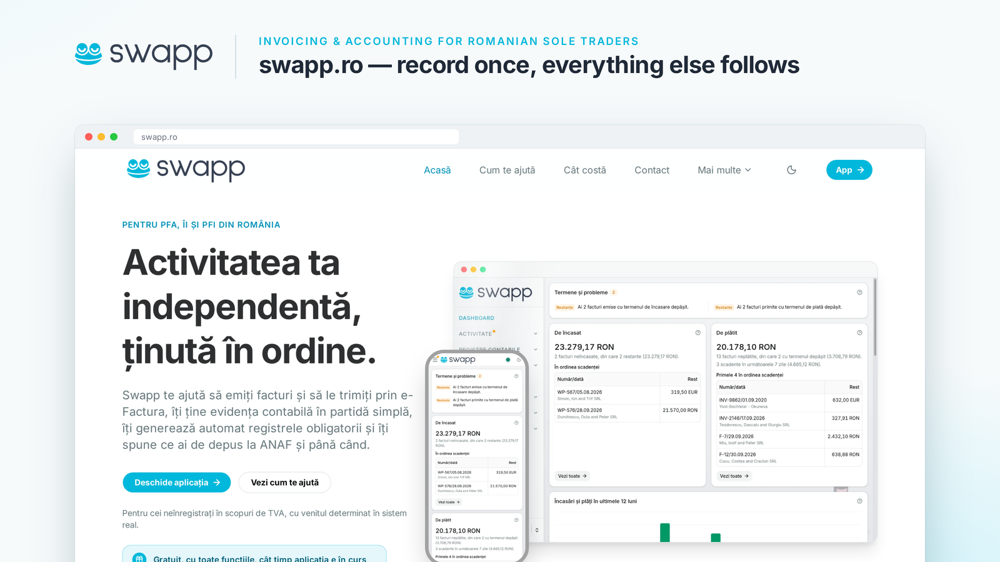

### [swapp.ro](https://swapp.ro) – facturare și contabilitate în partidă simplă pentru PFA, ÎI și PFI

Swapp te ajută să emiți facturi și să le trimiți prin e-Factura, îți ține evidența contabilă în partidă simplă, îți generează automat registrele obligatorii și îți spune ce ai de depus la ANAF și până când.

Pentru cei neînregistrați în scopuri de TVA, cu venitul determinat în sistem real.

**[Deschide aplicația](https://swapp.ro)** · [Cum te ajută](https://swapp.ro/cum-te-ajuta) · [Calculator taxe PFA](https://swapp.ro/taxe-pfa) · [Curs valutar BNR](https://swapp.ro/curs-valutar)

---

Invoicing and single-entry accounting for Romanian sole traders, at [swapp.ro](https://swapp.ro). The code of the current version is hosted on [Codeberg](https://codeberg.org/swapp-ro).
